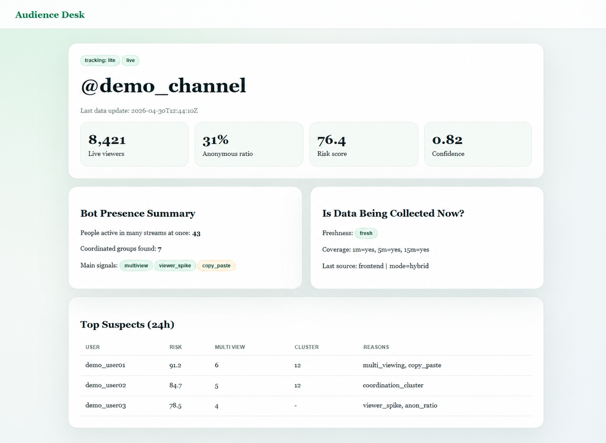
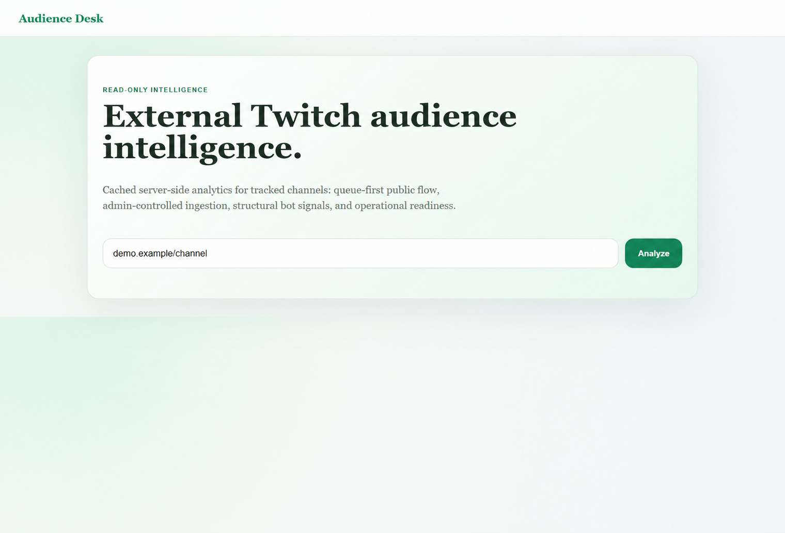
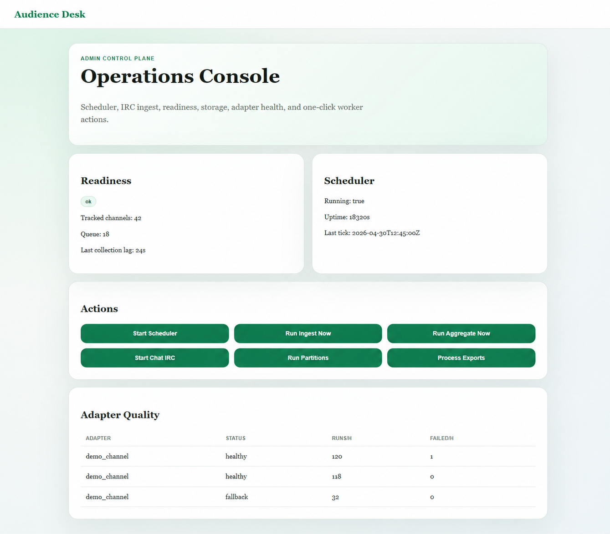

<a href="README.md">English</a> · <a href="README.ru.md">Русский</a>

<h1 align="center">Аналитика аудитории</h1>

Аналитическое пространство для изучения активности аудитории и показателей каналов.

   

Публичная витрина закрытого проекта. Здесь представлены обезличенные интерфейсы и основные сценарии; исходный код и внутренние материалы остаются приватными.

## Основные сценарии

- Просмотр обзора канала
- Сравнение сигналов активности
- Состояние сбора данных и обработки

## Галерея

Каждый экран показан отдельно с сохранением пропорций. Названия, контакты и данные заменены демонстрационными. Это визуальная презентация, а не подтверждение доступности рабочей службы.

Часть изображений обезличена с помощью AI.

### Обзор канала

### Поиск канала

### Состояние сбора данных

---

[Все проекты](https://github.com/svllvsx)
